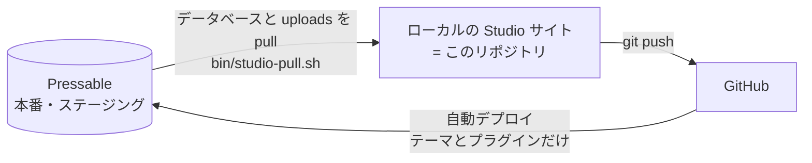

# pressable-site-template

Pressable でホスティングする WordPress サイトを構築するためのテンプレートです。
リポジトリのルートがサイトのルート（Pressable の `/htdocs`）に対応し、次の 2 つを管理します。

| ディレクトリ | 役割 |
| --- | --- |
| `wp-content/themes/pressable-theme/` | ブロックテーマ（FSE）。デザイントークン・テンプレート・パターン・CSS（見た目） |
| `wp-content/plugins/pressable-plugin/` | サイト固有の機能。独自ブロック・WooCommerce のカスタマイズなど |

ローカルでは、このリポジトリを [WordPress Studio](https://developer.wordpress.com/studio/) のサイトのフォルダにそのまま置きます。WordPress 本体・データベース・uploads・管理画面から入れるプラグイン（WooCommerce など）も同じフォルダにありますが、`.gitignore` で Git の管理から外しています。

## 全体の流れ



- コード（テーマ・プラグイン）は **ローカル → GitHub → Pressable** の一方向です。
- コンテンツ（データベース・メディア）は **Pressable → ローカル** の一方向です。
- Studio の push は使いません。本番のデータベースまで上書きされるためです。

## 構成

```text
.
├── .deployignore          # Pressable のデプロイ対象（テーマとプラグインだけをデプロイする許可リスト）
├── .github/workflows/     # CI（PHPCS・JS Lint・build/ の更新漏れチェック）
├── .gitignore             # Git で管理するファイルの許可リスト（Studio サイトの他のファイルは無視）
├── .phpcs.xml.dist        # WordPress Coding Standards の設定
├── bin/
│   ├── studio-prepare.sh  # ローカルサイトを開発用に整える（PHP・環境タイプ・有効化）
│   └── studio-pull.sh     # 本番からデータベースと uploads だけを pull する
├── composer.json          # 開発ツール（PHPCS）
├── CLAUDE.md              # 開発ルール（Claude Code 向け。人が読んでもよい）
├── docs/                  # レビューのバックログ・ベースライン
└── wp-content/
    ├── themes/pressable-theme/
    ├── plugins/pressable-plugin/
    └── mu-plugins/local-mail-guard.php  # ローカルでだけメール送信を止める（本番にはデプロイしない）
```

<!-- rename-site:start -->
テンプレートには、このほかに `.claude/skills/rename-site/`（サイト名・テーマ・プラグインの名前を一括変更するスキル）があります。新しいサイトのリポジトリでは、名前を変えた最後に削除します（下記「サイト名・テーマ・プラグインの名前を変更する」）。
<!-- rename-site:end -->

## 前提

- **WordPress Studio**: アプリをインストールし、**設定 > 一般 >「ターミナル用 Studio CLI」** を有効にします。新しいターミナルで `studio --version` が動けば準備完了です。
- **Studio の同期（Sync）**: Pressable のサイトで Jetpack を有効化し、Studio にログインしている WordPress.com アカウントで接続します。Jetpack Security は Pressable に含まれていますが、有効化と接続は手動です。Studio のログイン状態は `studio auth status` で確認できます。同期できるのはサイト全体で 5GB までです。

## 新しいサイトを始める

1. **本番（またはステージング）からローカルサイトを作る。**
   Studio でサイトを追加し、サイトの Sync（同期）タブで Pressable のサイトを接続して、**すべてを pull** します。PHP のバージョンは本番に合わせます。この時点では全体を pull してかまいません。他のプラグインやテーマも本番と同じ版で揃います。本番がまだ空の新規案件なら、空のサイトでもかまいません。

2. **GitHub でテンプレートから新しいリポジトリを作る。**
   このリポジトリのページで「Use this template」→「Create a new repository」を選びます。`gh repo create <owner>/<site-repo> --private --template <owner>/pressable-site-template` でも作れます。

3. **Studio のサイトのフォルダにリポジトリを取り込む。**

   ```bash
   cd ~/Studio/<サイトのフォルダ>
   git init -b main
   git remote add origin git@github.com:<owner>/<site-repo>.git
   git fetch origin
   git checkout -f -B main --track origin/main
   ```

   `-f` は、Studio が作った `CLAUDE.md`（中身は `@AGENTS.md` の 1 行）をリポジトリのもので置き換えるためです。それ以外の WordPress・Studio のファイルは `.gitignore` で無視されるので、`git status` には何も出ません。

4. **名前を案件用に変える。** このフォルダで Claude Code を起動し、rename-site スキルでサイト名・テーマ・プラグインの名前を変えます（<!-- rename-site:start -->下記「サイト名・テーマ・プラグインの名前を変更する」。<!-- rename-site:end -->スキルは最後に、このリポジトリから自分自身を削除します）。スキルの最後で `bin/studio-prepare.sh` が実行され、ローカルでテーマとプラグインが有効になります。

5. **pull 元を設定する。** `bin/studio-pull.sh` の `PULL_FROM` に、本番（またはステージング）の URL を設定します（例: `PULL_FROM="https://example.com"`）。

6. **コミットして GitHub に push する。** その後、下記「Pressable へのデプロイ設定」で GitHub 連携を設定します。初回のデプロイが済んだら、本番の管理画面でテーマとプラグインを有効化します。

7. **中身を差し替える。** テーマは `wp-content/themes/pressable-theme/CLAUDE.md` の「新しいサイトで最初に置き換える箇所」を参照し、機能は `wp-content/plugins/pressable-plugin/` に追加します。

<!-- rename-site:start -->
## サイト名・テーマ・プラグインの名前を変更する（rename-site スキル）

テンプレートのままのサイト名・テーマ・プラグインの名前を、案件の名前に一括で変更する Claude Code のスキルです（`.claude/skills/rename-site/`）。このリポジトリで Claude Code を起動すると使えます。

スキルの置き場所はテンプレートだけです。新しいサイトのリポジトリでは名前を変えた最後に、スキルと、この節のようなテンプレート用の記述を削除します（下記「使った後のスキルの削除」）。

### 使うタイミング

**リポジトリを Studio のサイトのフォルダに取り込んだ直後**（上の手順 4）に使います。初回デプロイ・コンテンツ作成より前に済ませてください。

公開後やコンテンツを作り込んだ後には使わないでください。WordPress は有効なテーマ・プラグイン、テーマの設定、エディターで保存したテンプレート、投稿内のブロック名をスラッグで覚えています。そのため、後からスラッグを変えると、テーマ・プラグインの無効化、保存済みテンプレートの消失、ブロックの表示崩れが起きます。

### 使い方

Claude Code で、サイト名・テーマ名とスラッグ・プラグイン名とスラッグを伝えます。

```text
/rename-site サイト名は「サンプル商店」、テーマは「Sample Store」（スラッグ sample-store）、
プラグインは「Sample Store Functions」（スラッグ sample-store-functions）にして
```

`/rename-site` を付けずに「サイト名・テーマ名・プラグイン名を変えて」と頼んでも使われます。スラッグを省略すると、名前から候補を作って確認されます。

スキルは次の順に進めます。

1. 変更内容を事前に表示（dry-run）
2. 一括変更（Git で管理しているファイルだけが対象で、WordPress 本体や他のプラグインには触れない）
3. 古い名前の残り・JSON・PHP 構文の自動チェック
4. ブロックの再ビルド（`npm run build`）、JS の lint（`npm run lint:js`）、PHPCS
5. `bin/studio-prepare.sh` で新しいテーマ・プラグインを有効化
6. このスキルをリポジトリから削除（下記「使った後のスキルの削除」）

コミットはしないので、差分を確認してからコミットしてください。

### 変更されるもの

| 対象 | 変更内容（例: テーマ sample-store・プラグイン sample-store-functions） |
| --- | --- |
| ディレクトリ・ファイル名 | `wp-content/themes/sample-store/`、`wp-content/plugins/sample-store-functions/sample-store-functions.php` |
| Text Domain・`@package` | `sample-store` / `sample-store-functions` |
| PHP の関数・変数・定数の接頭辞 | `sample_store_` / `SAMPLE_STORE_`、`sample_store_functions_` / `SAMPLE_STORE_FUNCTIONS_` |
| CSS クラス・パターン | `sample-store-card` などのクラス、`sample-store/hero` などのパターン、パターンカテゴリ |
| ブロック | `sample-store-functions/copyright`（テーマのフッターの参照も含む） |
| 設定ファイル | `.gitignore`、`.deployignore`、`.phpcs.xml.dist`、CI（`.github/workflows/lint.yml`）、`bin/studio-*.sh`、package.json |
| 名前 | `Theme Name`・`Plugin Name`、説明文のサイト名、README.md の見出し |
| ドキュメント | README.md・各 CLAUDE.md の中のパスや名前 |

### Claude Code を使わずに実行する場合

同梱のスクリプトを直接実行できます。まず `--dry-run` で確認し、問題なければ外して実行します。

```bash
python3 -I .claude/skills/rename-site/scripts/rename.py \
  --site-name "サンプル商店" \
  --theme-name "Sample Store" --theme-slug sample-store \
  --plugin-name "Sample Store Functions" --plugin-slug sample-store-functions \
  --dry-run
```

実行後は次の 4 つを行ってください。

1. プラグインのディレクトリで `npm ci && npm run build && npm run lint:js`（build/ の作り直しと、整形の確認。lint のエラーは `npx wp-scripts lint-js src --fix` で直る）
2. リポジトリのルートで `composer lint`
3. `bin/studio-prepare.sh`
4. リポジトリのルートで `python3 -I .claude/skills/rename-site/scripts/rename.py --remove-skill`（このスキルの削除。先に `--dry-run` を付けて確認できる）

### 使った後のスキルの削除

名前を変えるのはリポジトリを作った直後の 1 回だけなので、サイトのリポジトリにはスキルを残しません。残すと案件ごとに古い版のスキルが増え、テンプレートで直した内容が届きません。`rename.py --remove-skill` は次のものを削除します。

- `.claude/skills/rename-site/`（スキル本体）
- `.gitignore` の `!/.claude/skills/rename-site/` の行と、CI（`.github/workflows/lint.yml`）のスキルのテストのジョブ
- README.md・CLAUDE.md の、テンプレートにだけ必要な記述（この節など）
- `docs/reviews/`（テンプレート自身のレビュー記録）
- `docs/review-backlog.md` の中身（テンプレートで後回しにした指摘。表の見出しだけを残し、案件のレビューで追記できるようにする）

`docs/review-baseline.md`（レビューで許容した書き方）は残します。案件も同じコードを受け継ぐので、案件のレビューでもそのまま有効です。テンプレートで後回しにした指摘は、テンプレートで直します（これから作る案件にはそのまま入ります）。

削除する範囲は、各ファイルで `rename-site:start` と `rename-site:end` のコメントで囲んであります。テンプレートにだけ必要な記述を足すときは、同じように囲んでください。

テンプレート自身（origin が pressable-site-template のリポジトリ）では、名前の変更もスキルの削除も実行されません。

### 削除した後に名前を変える場合

公開後は名前を変えない前提ですが、どうしても必要なときは、手元のテンプレートのスクリプトを `--repo` でサイトのリポジトリを指定して実行します（テンプレートは先に `git pull` で最新にしておきます）。

```bash
cd ~/Studio/<サイトのフォルダ>
python3 -I ~/Dev/pressable-site-template/.claude/skills/rename-site/scripts/rename.py --repo . \
  --site-name "サンプル商店" \
  --theme-name "Sample Store" --theme-slug sample-store \
  --plugin-name "Sample Store Functions" --plugin-slug sample-store-functions \
  --dry-run
```
<!-- rename-site:end -->

## ローカル開発（WordPress Studio）

### 日常の操作

リポジトリのルート（＝ Studio のサイトのフォルダ）で実行します。

```bash
studio start                 # 起動
studio stop                  # 停止
studio status                # URL・ログイン情報
studio wp plugin list        # WP-CLI は必ず studio wp 経由で実行する
bin/studio-prepare.sh        # PHP・環境タイプ・デバッグログを整え、テーマとプラグインを有効化する
```

- テーマ・プラグインのファイルを編集すると、そのままローカルサイトに反映されます。ブロックを編集するときは `npm run start` でビルドしながら確認します。
- PHP のエラーは `wp-content/debug.log` に記録されます。画面にも表示したい場合は `studio config set --debug-display` を実行します。

### 本番のコンテンツを取り込む（データベースと uploads）

```bash
bin/studio-pull.sh                                                # PULL_FROM に設定したサイトから
bin/studio-pull.sh --remote-site https://staging-xxxx.example.com  # 別の環境（ステージングなど）から
```

`PULL_FROM` が空で `--remote-site` も付けない場合は、Studio が WordPress.com アカウントの **全サイトの一覧** から pull 元を選ばせます。選び間違えると、ローカルのデータベースが別サイトの内容で上書きされるので、`PULL_FROM` を設定しておいてください。なお、Claude Code など対話できない環境から実行した場合は、選択画面では止まらず、エラーで終了します。

スクリプトは次の順に処理します。

1. Git 管理下のファイルに未コミットの変更があれば止める
2. `studio pull --options sqls,uploads` で、データベースと uploads だけを pull する（ローカルのデータベースと uploads は上書きされる）
3. pull の後に Git 管理下のファイルが変わっていないかを確認する
4. `bin/studio-prepare.sh` を実行する。pull で変わる PHP のバージョンと環境タイプを戻し、テーマとプラグインを有効化する

テーマ・プラグインは pull しません。pull に含めると、未コミットの作業が本番の版で上書きされるためです。

### 他のプラグイン・テーマを本番の版に合わせる

- **Studio の Sync で選んで pull する（おすすめ）**: Sync の pull で範囲を「特定のファイルとフォルダ」にし、`plugins` / `themes` から **自分のテーマ・プラグイン以外** を選んで pull します。先にコミットしておけば、誤って自分のテーマ・プラグインを含めても `git status` で気づき、`git restore .` で戻せます。終わったら `bin/studio-prepare.sh` を実行します。
- **手動で合わせる**: 本番の管理画面でバージョンを確認し、ローカルで同じ版を入れます。例: `studio wp plugin install woocommerce --version=<本番の版> --force`

### ローカルからのメール送信を止める仕組み

本番のデータベースには、顧客のメールアドレスや SMTP の設定が入っています。`wp-content/mu-plugins/local-mail-guard.php` が、環境タイプが `local` のときだけ `wp_mail()` の送信を止め、宛先と件名を `wp-content/debug.log` に記録します。

環境タイプは `bin/studio-prepare.sh` が毎回 `local` に戻します。このファイルは `.deployignore` により本番にはデプロイされません。万一置かれても、`local` 以外の環境では何もしません。

### 注意

- **`studio push` は使わない。** 接続先の Pressable のデータベースまで上書きします（WooCommerce なら注文・顧客データも消えます）。コードは GitHub 経由でデプロイします。
- **`studio delete` はフォルダごとゴミ箱に移す。** 既定ではサイトのフォルダ、つまりリポジトリごとゴミ箱に移します。Studio から外すだけなら `studio delete --no-files` を使います。
- **本番のデータの扱いに注意する。** ローカルのデータベースには本番の顧客情報が入ります。PC の管理に注意してください。データベースのファイル（`wp-content/database/`）は `.gitignore` によりコミットされません。
- **リポジトリに入れるファイルを増やすとき。** ルートにファイルを追加したり、別のテーマ・プラグインをリポジトリに入れたりする場合は、`.gitignore` と `.deployignore` の両方に `!` の行を追加します。
- **対応 OS。** `bin/` のスクリプトは macOS 向けです。

## 開発

```bash
# PHPCS（WordPress Coding Standards）
composer install
composer lint            # 自動修正は composer lint:fix

# 独自ブロック（pressable-plugin）
cd wp-content/plugins/pressable-plugin
nvm use && npm ci
npm run build            # src/ → build/。開発中は npm run start
npm run lint:js
```

Pressable はデプロイ時にビルドしないため、**`build/` はコミットします**。CI（`.github/workflows/lint.yml`）が PHPCS・ESLint・build/ の更新漏れをチェックします。<!-- rename-site:start -->テンプレートでは、rename-site スキルのシナリオテスト（`python3 -I .claude/skills/rename-site/scripts/test_rename.py`）も実行します。<!-- rename-site:end -->

## Pressable へのデプロイ設定

Pressable の GitHub 連携（MyPressable Control Panel の サイト > Advanced > GitHub Integration）で次のように設定します。

| 項目 | 設定値 |
| --- | --- |
| Branch | `main` |
| Repository Subdirectory | 空欄（リポジトリのルート） |
| Destination Path | 空欄（`/htdocs`） |

### 重要: デプロイでファイルが削除される仕組み

Pressable のデプロイは **Sync-As-Is** 方式で、**デプロイ先にあってリポジトリに無いファイルはサーバーから削除されます**。自動で保護されるのは WordPress 本体、uploads、wp-config.php、一部の管理プラグイン（Jetpack・Akismet など）だけで、管理画面から入れた WooCommerce などは保護されません。

そこで `.deployignore` を **許可リスト方式** にしています。`.deployignore` に一致したパスはデプロイも削除もされないため、テーマ `pressable-theme` とプラグイン `pressable-plugin` 以外（他のプラグイン・テーマ、`languages/`、`mu-plugins/`、SFTP で置いたファイルなど）はサーバー上のまま残ります。

- `.deployignore` は連携を有効にする **前に** main へ push しておきます。
- リポジトリに別のテーマ・プラグインを追加した場合は、`.deployignore` に `!wp-content/plugins/<スラッグ>/` のような行を追加します（追加しないとデプロイされません）。
- Pressable のドキュメントは `.deployignore` を「gitignore に近い書式」としていますが、先頭の `/`（ルート基準）の扱いは明記されていません。そのため `wp-content/` 配下の行はドキュメントの例と同じ先頭 `/` なしの書き方にしてあり、`/` が解釈されない場合でも他のプラグイン・翻訳ファイル・mu-plugins は保護されます（その場合に消える可能性があるのは、サイト直下に SFTP などで置いた独自ファイルだけです）。
- **初回はバックアップを取ったうえでステージングサイトで試し**、管理画面から入れたプラグインや翻訳ファイルが残ること、テーマとプラグインが更新されること、README.md などの開発用ファイルがサーバーに置かれていないことを確認してから本番に設定してください。

参考:

- [Deploy from GitHub（Pressable Knowledge Base）](https://pressable.com/knowledgebase/deploy-from-github/)
- [GitHub integration: configurable deployment paths and .deployignore support（Pressable Changelog）](https://pressable.com/changelog/new-github-integration-configurable-deployment-paths-deployignore-support/)
- [Studio for Pressable（Pressable Knowledge Base）](https://pressable.com/knowledgebase/studio-for-pressable/)
- [Studio Sync（WordPress.com Developer Docs）](https://developer.wordpress.com/docs/developer-tools/studio/sync/)

## 運用上の注意

- エディターで保存したテンプレート・テンプレートパーツはデータベースに保存され、テーマのファイルより優先されます。ファイルを更新しても表示が変わらない場合は、エディターでテンプレートをリセットするか、エディター側でも同じ変更を行います。本番のデータベースを pull すると、本番で保存されたテンプレートもローカルに入ります。
- テーマのパターン一覧は最大 30 分キャッシュされます。ローカルですぐ反映したいときは `studio wp eval 'wp_get_theme()->delete_pattern_cache();'`、本番では `style.css` の `Version` を上げます。
